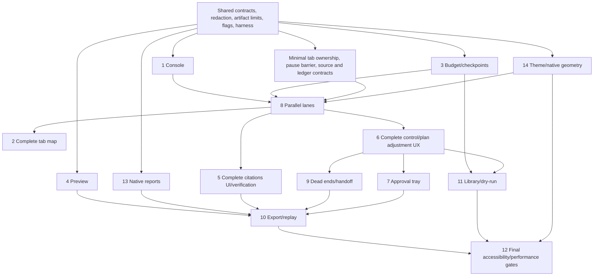

# Agent UX upgrade — implementation and review plan

Status: **Planning only; awaiting user review before implementation.**
Baseline: `main` at `b5bbb3d7475634306dc7df07f3aea4521a80ecde`. Prepared October 18, 2026.

## Product outcome and protected boundaries

A user should be able to follow a real research run, understand its sources and budget, interrupt it without losing progress, and receive a polished report plus a replayable record. The investor demo must demonstrate these capabilities against real browser-controlled portals. Simulated fixtures are test evidence, not evidence of a successful live run. Competitive positioning is an aspiration to validate, not an established comparison.

Preserve identity, authorization, exact-action safety confirmations, approved-profile grounding, official-source requirements, existing provider/reasoning contracts, and the browser automation layer. Reading a page does not make it a citation; finding an opportunity does not establish eligibility. Never expose private model reasoning: “Why” explains the declared plan and observable prior evidence only. Preserve existing accessibility preferences and update/install safety. The latest specification supersedes earlier white-chat layout requests, but the right web surface remains white.

This document changes no application behavior. Tracking issues and a documentation-only draft PR accompany it. Implementation begins only after this plan is reviewed. Each workstream can span multiple small PRs; an issue closes only after its entire acceptance evidence is attached.

## Repository findings

- Existing stack: React 19, Zustand 5, Tailwind 3, Vite 6, Electron 39, Vitest 4, Playwright 1.60. Retain these. There is no current Storybook, hosted organization-sharing service, or native report writer.
- `packages/agent-core/src/agent-loop.ts` already records tool timing through `onToolRecord`, but the desktop host does not connect that callback to its activity UI. Current renderer matching by tool name is unsuitable for concurrent lanes.
- `apps/desktop/src/main/tabs/manager.ts` controls real `WebContentsView` tabs and emits lifecycle updates. Reuse it rather than poll or introduce a second browser driver.
- Native browser views sit above renderer DOM. Panels need actual reserved native bounds; CSS z-index cannot fix overlap. Current layout is browser-left/chat-right; the requested geometry reverses it.
- Existing budget accounting is weighted (cheap 0.5, ordinary 1, expensive 2; default 40, maximum 200). Preserve these limits and distinguish action count from weighted budget units.
- Existing checkpoints are update-session restoration, not durable agent continuation. Current successful-read deduplication is not a canonical URL plus content hash cache.
- Existing PDF/DOCX modules read documents; they do not generate report exports. Organization profiles do not presently supply approved logo/contact fields.
- Local identity roles are not hosted authentication. The reference widget backend is not an organization-scoped sharing service. Architecture documentation contains stale details; implementation follows audited source.

## Decisions requiring review

| ID | Conflict or missing prerequisite | Proposed resolution and release gate |
| --- | --- | --- |
| R1 | WS1 says right-docked console; WS14 says left chrome and right white browser. Four visible panes do not fit the current minimum window. | Dock console at the right edge of the left operator workspace, immediately beside preview and the right browser. At small sizes switch Browser/Deliverable views and collapse console to ticker. Review this interpretation before geometry work; no overlay on native content. |
| R2 | “Approve all of type for this task” grants authority beyond existing exact-action confirmations. | Preserve exact previews and approvals. Offer a finite batch containing fully known actions, with individually recorded decisions. Unknown future actions still prompt. Unrestricted future-type grants remain unimplemented unless the protected-policy constraint is explicitly reconciled. |
| R3 | Agent-declared plans, sections, lanes and three future actions are not a structured protocol today, while reasoning/prompt contracts are out of scope. | Start with host/user-declared execution metadata and observable tool events. Spike how existing outputs supply declarations without changing reasoning. Any necessary prompt/protocol change requires explicit scope review; do not fabricate future plans or “dry-run” by executing actions. |
| R4 | Private organization share links require authenticated hosting and membership checks absent from this repository. | Keep sharing flag off until backend ownership, auth integration, storage, revocation and hosting are approved. Local export/replay can ship independently. Public unguessable URLs are not an acceptable substitute. |
| R5 | Exact Smoky Black default and respecting system color scheme can conflict. | Propose explicit Smoky Black product theme with an optional System preference; accessibility overrides remain available. Review default behavior. White web content is unchanged in every mode. |
| R6 | “Under 150MB” does not identify renderer, console increment, or total Electron/browser memory. | Measure all three and propose a 150MB incremental console/session renderer allocation for 1,000 steps. Obtain target approval; do not silently redefine acceptance. Name reference laptop and power conditions before setting performance baselines. |
| R7 | Byte-identical PDF across OS/font/Chromium differences and repair-free behavior in every named reader cannot be assumed. | Pin renderer/fonts and freeze model metadata. First spike repeatability across fresh renders on the release platform; define cross-platform scope explicitly. Actual reader/account access is a release prerequisite, not replaced by parser tests. |
| R8 | Branding fields are absent; new users may lack an approved profile. | Omit unsupported branding cleanly. Two-click demo uses a previously approved profile and saved parameters; first-use setup is disclosed. Never infer profile claims from uploaded material without approval. |

If these decisions are unresolved, affected features remain off and the investor-ready release remains blocked. They do not justify weakening safety or claiming incomplete requirements are done.

## Component tree and native surface boundary

```text
DesktopWindow
├─ ChromeShell [Smoky Black; ThemeTokens]
│  ├─ AddressBar → YourAssistant / Update / CircularBrandControl
│  ├─ AgentTabStrip
│  └─ OperatorWorkspace [left; resizable native-layout allocation]
│     ├─ ChatPanel → PromptLibrary / Composer / ResumeCheckpoint / AdjustTask
│     └─ OperatorConsole [right dock within workspace; collapsed ticker default]
│        ├─ BudgetMeter → SectionBreakdown
│        ├─ RunControls → Pause / Resume / Stop / DryRunReview
│        ├─ TabMap → TabTile / Pin / CloseNoise
│        ├─ LaneStrip → LaneStatus / JoinPreview
│        ├─ ConsoleFilters / Search / DensitySelector
│        ├─ VirtualActionList → PlanGroup / ActionRow / WhyPopover
│        ├─ ActionInspector → JsonViewer / CopyActions
│        ├─ SourcesSidecar → Citation / Verify / Export
│        ├─ ApprovalsTray → ActionDiff / Edit / FiniteBatchReview
│        ├─ DeadEndsLedger → Handoff / ReturnControl
│        └─ SessionActions → DownloadReport / SaveWorkspace / Replay / Share
├─ DeliverablePreview [read-only; next to console; reserved bounds]
│  └─ HeadingNavigator / ObservedSurfaceSnapshot / OutlineFallback / DownloadReport
└─ WebContentSurface [right; WHITE; native WebContentsView]
   └─ Intro video/start screen OR actual browser-controlled website

Main process: EventJournal → RunCoordinator → existing ToolRuntime / TabManager
              ├─ CheckpointStore / ReadCache / BudgetLedger
              ├─ LaneScheduler / ApprovalBroker / HandoffRegistry
              ├─ DeliverableObserver / SourceRegistry / ReportBuilder
              └─ ArtifactStore / SessionExporter / ReplayReader
```

Console and preview never clone an authenticated editor into a second controllable surface. Dialogs either reserve bounds or use the existing native-view hiding mechanism. Keyboard-resizable separators must preserve usable browser space at minimum size, zoom and large text.

## Shared contracts and event schema

Proposed shared files live under `apps/desktop/src/shared/agent-ux/`; browser-independent executor event hooks live in `packages/agent-core/src/types.ts` and `agent-loop.ts`. Version persisted contracts independently of React components.

```ts
interface AgentEventV1 {
  schemaVersion: 1;
  eventId: string; sessionId: string; runId: string;
  sequence: number; timestamp: string; monotonicMs: number;
  kind: 'plan' | 'section' | 'tool.started' | 'tool.finished' |
    'budget' | 'tab' | 'citation' | 'deliverable' | 'checkpoint' |
    'control' | 'approval' | 'lane' | 'deadEnd';
  callId?: string; step?: number; laneId?: string; sectionId?: string;
  payload: VersionedPayloadByKind;
}
interface ToolFinishedV1 {
  tool: string; summary: string; elapsedMs: number;
  outcome: 'succeeded' | 'failed' | 'denied' | 'cancelled';
  httpStatus?: number; // only an observed HTTP response, never invented
  arguments: RedactedJson; result: RedactedJson;
  artifactRef?: string; // bounded, authorized detail loaded on demand
  planContext?: string; priorObservationRef?: string;
}
```

The actual implementation uses a discriminated union, validates IPC payloads, and tests unknown-version rejection/migration. The sample is design documentation, not production code. Stable call IDs match concurrent starts/results; monotonic timing handles wall-clock adjustments. Ordered sequence numbers support reconnect, replay and duplicate suppression. Host-generated action IDs must not imply model-declared plans. The console shows truthful outcome labels and real HTTP codes only where available. Copy-as-curl is enabled only for a reconstructable non-sensitive HTTP request; native clicks are not HTTP requests.

Redact BEFORE IPC, journal, checkpoints or export: credentials, cookies, tokens, hidden form fields, sensitive payload values and organization-document bodies. Current raw step detail is a known gap to close in the foundation PR. Console detail uses the same redacted representation as the journal. Explicit local verbose mode may reveal only permitted user-visible content with bounded retention; secrets are never persisted/exported. Copy operations cannot bypass redaction. Rate-limit live announcements and stream lightweight normalized entities; lazy-load bounded detail artifacts instead of retaining repeated large payloads.

Other versioned contracts:

- `RunStateV1`: declared plan revisions, current action/section, safe provider continuation, budget, status and side-question branch. Checkpointing must not serialize secrets or private reasoning.
- `CheckpointV1`: organization/user/workflow/run IDs, sequence, plan, tab ownership/pins, approved scratchpad, partial report, sources, dead ends, continuation reference and cache manifest. Write every 5 completed actions (configurable), each section boundary and before Stop. Atomic, versioned, quota-aware local persistence; localStorage holds a small pointer/index, large payloads use the bounded local artifact store.
- `ReadCacheV1`: canonical URL plus observed content hash, tab/document revision and approved session scope. Resume reuses unchanged session observations. Navigation, user edits, login transitions or freshness requests invalidate entries; no claim to detect remote changes without observing them. Strip fragments/default ports and normalize safely; never remove semantically meaningful query parameters blindly.
- `ReportDocumentV1`: frozen title/metadata/generation timestamp, approved branding, ordered typed sections, paragraphs/lists/native tables/quotes, citations, sources, methodology and ledger-derived dead ends. One immutable model drives all formats and replay.
- `TabRecordV1`, `SourceV1`, `ApprovalV1`, `LaneV1`, `DeadEndV1`: stable IDs, ownership and provenance; user-initiated activity is not mislabeled agent activity. URLs are checked at observation/export boundaries.

## ThemeTokens and feature flags

Add `packages/brand-tokens/src/theme-tokens.ts`, exported from its existing index. Export palette, semantic roles, spacing, radii, type scale and motion durations; expose CSS variables/Tailwind adapters. No new frontend framework, state library or backend runtime is planned.

| Role | Value | Contrast against #101720 |
| --- | --- | --- |
| chrome / input fill | `#101720` (16, 23, 32) | — |
| primary text / icons | `#F5F7FA` | 16.79:1 |
| secondary | `#AEB6C2` | 8.81:1 |
| placeholder | `#7A8494` | 4.77:1 |
| accent / focus | `#20BAD1` | 7.73:1 |
| white outline / active tab underline | `#FFFFFF` | 18.02:1 |
| error | `#EF4444` | 4.79:1 |
| rest border / scrollbar thumb | `#2A313B` | decorative; not sole state indicator |
| divider | `#1C232E` | decorative |
| web/start background | `#FFFFFF` | separate surface; unchanged |

Verify computed styles and opacity-composited colors, not just this token table. Use accent focus borders plus 2px keyboard rings; inactive opacity cannot reduce readable tab text below AA. Your Assistant and Update have transparent fills and white 1px outlines. Circular control uses exact chrome fill, white 1px outline and centered 16×16 near-white SVG. Spacing proposal: 4/8/12/16/24/32px; radii 4/8/12/999px; typography 12/14/16/20/24/32px with role-specific line heights. Density changes spacing/row heights without changing semantic structure. Reduced motion removes decorative movement, including composer halo; preserve the existing focus/input-only activation behavior.

Flags are local/organization-aware configuration values, default OFF, not authorization grants. Main and renderer consume one resolved snapshot. Export manifests record enabled flags and schema versions. Unknown flags default off.

| WS | Flag |
| --- | --- |
| 1 | `agentUx.operatorConsole` |
| 2 | `agentUx.liveTabMap` |
| 3 | `agentUx.checkpoints` |
| 4 | `agentUx.deliverablePreview` |
| 5 | `agentUx.citations` |
| 6 | `agentUx.runControls` |
| 7 | `agentUx.approvalsTray` |
| 8 | `agentUx.parallelLanes` |
| 9 | `agentUx.deadEnds` |
| 10 | `agentUx.sessionArtifacts` and subordinate `agentUx.orgSharing` |
| 11 | `agentUx.promptLibrary` and subordinate `agentUx.dryRun` |
| 12 | `agentUx.consoleDensity` (accessibility correctness is mandatory regardless of flag) |
| 13 | `agentUx.nativeReports` |
| 14 | `agentUx.smokyChrome` |

## Dependency graph and delivery sequence



First merge independently reviewable shared primitives. Then run WS1/3/4/13/14 as parallel implementation branches, coordinating shared files through the foundation contracts. WS8 follows; extract its minimum WS2 ownership, WS6 pause, WS5 source and WS9 ledger primitives early rather than pretending lanes can run safely without them. Complete the remaining workstreams in graph order. Accessibility, test fixtures, redaction and performance budgets start in every PR; WS12 is final consolidation, not postponed accessibility work. Authenticated sharing is an additional gated dependency outside the current local runtime.

Target each PR below roughly 800 changed lines including tests where practical. Split by contract/runtime/UI/evidence rather than omit tests to meet the target. Each split preserves flags-off behavior, compiles independently, references its tracking issue and includes its own evidence. No implementation PR is created before implementation exists. Do not merge this plan or start implementation until review.

## File-by-file workstreams, demos and PR slices

Path shorthand: **D** = `apps/desktop/src`; **C** = `packages/agent-core/src`; **B** = `packages/brand-tokens/src`. Paths marked new are proposed, not existing capabilities. Each directory entry enumerates intended files; refine exact names in its first PR without broadening scope.

### Foundation — extracted shared primitives

Files: modify `C/types.ts`, `C/agent-loop.ts`, `D/shared/agent-events.ts`, `D/shared/ipc.ts`, `D/main/agent/run.ts`; new `D/shared/agent-ux/{events,flags,contracts,redaction}.ts`, `D/main/agent-ux/{journal,artifact-store}.ts`, `D/renderer/state/operator-store.ts`. Add colocated schema/redaction/order/retention tests. Add a development-only isolated component harness via a separate Vite entry and fake preload bridge, excluded from packaged output. Its state matrix covers empty/loading/error/long-content/dense/reduced-motion plus default/hover/focus/active/disabled/loading chrome states.

PR slices: event schema and redaction; bounded journal and IPC bridge; flags and harness. No new state framework. Normalize existing Zustand state rather than append unbounded copies. Demo: one real tool start/result appears with matching ID and redacted detail, with old UI unchanged when flags are off.

### 1 — Operator Console

Files: modify `D/renderer/components/{AiPanel,TaskActivity}.tsx`, `D/renderer/state/agent-store.ts`; new `D/renderer/components/operator/{OperatorConsole,ConsoleTicker,ConsoleFilters,VirtualActionList,ActionRow,ActionInspector,JsonViewer,PlanGroup}.tsx`, `D/renderer/lib/operator-copy.ts`, and colocated tests/stories. Foundation owns runtime instrumentation; do not instrument each provider separately.

Use fixed-height virtual rows and a separate lazy expanded inspector to avoid variable-height layout churn. Existing Shiki may supply a lazily imported JSON grammar only after bundle measurement; otherwise use a small bounded JSON renderer. Persist ticker/expand preference per user and workflow. Filters include every requested category and free text. Unknown total displays “step 17” rather than inventing “of 25.”

PR slices: ticker/store; list/filter/grouping; inspector/copy. Depends on foundation; aligns native geometry with WS14. Demo: expand ticker during a real run, inspect a row, copy redacted JSON/Markdown and applicable curl, filter Errors, collapse and reopen after workflow reload. Investor note: users can inspect the work as it happens without losing the simple chat entry point. Gate: 500-row scrolling, call-to-render latency, accessible labels and persisted preferences.

### 2 — Live Tab Map

Files: modify `D/main/tabs/manager.ts`, `D/main/agent/runtime.ts`, `D/shared/ipc.ts`, preload bridge and tab store; new `D/shared/agent-ux/tabs.ts`, `D/renderer/components/operator/{TabMap,TabTile}.tsx`; native ownership/lifecycle integration tests.

Add creation-step/lane/agent-ownership/pin metadata to existing lifecycle events; reconcile real navigation/title/favicon/close events. Focus through existing tab tooling. Close Noise excludes pinned user working surfaces and user-opened tabs; preserve current close-tab confirmation policy. No polling.

PR slices: ownership primitive before WS8; tray and cleanup after WS8. Demo: open four research portals, pin the actual Word tab, switch via tile, close allowed noise, verify pinned document remains and manual tab closure disappears immediately. Investor note: users see and control the agent's real research workspace. Gate: lifecycle synchronization, ownership and pin preservation.

### 3 — Budget Meter and Checkpoints

Files: modify `C/budget.ts`, `D/main/agent/run.ts`; new `D/main/agent-ux/{budget-ledger,checkpoint-store,read-cache,continuation}.ts`, `D/shared/agent-ux/checkpoint.ts`, `D/renderer/components/operator/{BudgetMeter,SectionBreakdown}.tsx`, chat `ResumeCheckpoint.tsx`. Existing update-session and conversation stores remain separate.

Emit each actual budget charge and action count. Amber at 75%, red at 90%; section totals and wall time reconcile with global totals. Atomic checkpoint references point to bounded artifacts with organization/user authorization. Checkpoint recovery validates schema, ownership and missing/expired tabs before offering resume. A side question uses a separate branch and cannot overwrite the active run continuation. Durable continuation must work with each supported provider or explicitly block unsupported recovery.

PR slices: ledger UI; checkpoint persistence; cache/continuation and resume. Demo: interrupt after several official pages, ask a side question, resume with network trace proving zero reads of unchanged cached URLs, then stop and recover from saved state. Investor note: long research work survives interruptions with visible resource use. Gate: weighted accounting, quota/corruption tests, restart recovery and zero duplicate-fetch test.

### 4 — Deliverable Preview Pane

Files: modify `D/main/agent/runtime.ts`, existing capture IPC and native bounds; new `D/main/deliverables/{registry,observer,snapshot,handlers}.ts`, `D/shared/agent-ux/deliverables.ts`, `D/renderer/components/deliverables/{DeliverablePreview,HeadingNavigator,OutlineFallback}.tsx`, observer and UI tests.

Read-only mirror captures the actual authorized browser editor after observed writes and document changes; adapters handle Word, Docs, spreadsheets and drafts. Spike canvas/frame observation first. Throttle only subscribed visible previews; do not equate attempted typing with persisted content. If mirroring is unavailable, show last observed outline, timestamp and Reload. Heading navigation changes preview position only unless the user explicitly asks to focus the source.

PR slices: observer capability spike; snapshot/outline service; preview pane. Depends on foundation and native-layout agreement, shares report section IDs with WS13. Demo: write into an authorized Word document, watch the same section appear beside the console, choose a heading, force capture failure and reload the timestamped fallback. Investor note: users can watch deliverables take shape without switching tabs. Gate: actual-surface parity, read-only isolation and fallback tests.

### 5 — Citations Sidecar

Files: new `D/main/agent-ux/{source-registry,source-verifier}.ts`, `D/shared/agent-ux/sources.ts`, `D/renderer/components/operator/{SourcesSidecar,CitationRow}.tsx`, `D/renderer/lib/source-export.ts`; connect existing grounding/citation outputs without changing `D/main/funding/grounding.ts` policy.

Deduplicate safely canonicalized citation URLs, retaining all citing steps/snippets. Classification uses verified provenance, not a `.org` suffix. Official funding-only rules remain enforced; injected aggregators remain visible red violations and cannot silently count as eligible evidence. Verify in an existing-tool background tab, reporting observed redirects/status and uncertain paywall classification without bypassing access controls. Preserve tab ownership and politeness.

PR slices: registry primitive early; UI/exports; verification. Demo: cite the same official source twice, inject one aggregator in a test fixture, see one deduplicated source and a red flag within one second, export MD/BibTeX/CSV, verify controlled 404/redirect/paywall fixtures. Investor note: report evidence is visible and independently inspectable. Gate: escaping/export tests, provenance and latency.

### 6 — Interrupt and Redirect

Files: modify `C/agent-loop.ts` execution barrier, `D/main/agent/run.ts`, native menu/input shortcut routing and chat controls; new `D/main/agent-ux/{run-coordinator,plan-patch}.ts`, `D/renderer/components/operator/{RunControls,AdjustTask,PlanDiff}.tsx` and state-machine integration tests.

Pause after current action, never midway through a destructive operation. Stop checkpoints before termination. Resume preserves step, cache and budget. Side questions cannot mutate the paused plan. Show exact plan patch before approval; denying leaves original continuation intact. Keyboard controls work even while native browser content holds focus; ordinary typing must not trigger them.

PR slices: minimal pause/ownership primitive before WS8; complete side-question/adjustment UI after WS8. Demo: pause from browser keyboard focus, ask a question, propose dropping a portal, reject then approve the visible diff, resume at the same next action. Investor note: users steer ongoing work without restarting it. Gate: race/cancellation/approval tests and no duplicate fetches.

### 7 — Approvals Without Flow Breaks

Files: preserve `C/{policy,permissions}.ts` semantics; modify transport in `C/types.ts`, `D/main/agent/run.ts`, `D/shared/agent-events.ts`; new `D/main/agent-ux/approval-broker.ts`, `D/renderer/components/operator/{ApprovalsTray,ActionDiff,EditApproval,FiniteBatchReview}.tsx` and authorization tests.

Carry existing structured ActionPreview instead of flattening it into a message. Display URL/method/fields/files/step with redaction and meaningful diffs. A/D/E apply only when an approval has intentional focus and no text field is editing. Editing regenerates the exact reviewed action and revalidates policy. Preserve confirmations for sends, uploads, downloads, forms and purchases. Audit approved/denied/edited decisions. R2 gates broad future-type scope.

PR slices: structured preview transport; tray/shortcuts; finite batch audit. Demo: fixture form submission pauses, keyboard edits one field, approves the exact diff; a later unknown action still asks. Investor note: users approve consequential actions with context at the moment it matters. Gate: no default grants, stale-preview protection and existing policy regression suites.

### 8 — Parallel Lanes

Files: new `D/main/agent-ux/{lane-scheduler,origin-limiter,join-coordinator}.ts`, `D/shared/agent-ux/lanes.ts`, `D/renderer/components/operator/{LaneStrip,LaneStatus,JoinPreview}.tsx`; modify `D/main/agent/{runtime,run}.ts`, tab context and existing budget integration.

Current globally active tab getter makes naive Promise.all unsafe. Bind each lane to explicit owned tab context, serialize conflicting focus-sensitive actions and human handoffs, cap four lanes, share an atomic global budget, and enforce per-origin spacing/backoff. Scheduler metadata must not change reasoning or duplicate automation. Per-lane results are immutable inputs to a user-approved Join; no concurrent writes into the same editor. Structured agent lane declarations require R3 resolution.

PR slices: lane-bound runtime context; scheduler/limits; lane UI; Join preview and reference demo. Depends on WS1/3/14 and extracted tab/control/source/ledger primitives. Demo: SAM.gov, Washington WEBS, King County and Seattle run as four observable lanes, one slows without corrupting others, then approve merged findings before document write. Investor note: independent research progresses concurrently and joins into one reviewed deliverable. Gate: tab isolation, four-lane cap, fairness, global-budget races and real-portal evidence.

### 9 — Dead-Ends Ledger

Files: new `D/main/agent-ux/{dead-ends,handoff-registry}.ts`, `D/shared/agent-ux/dead-ends.ts`, `D/renderer/components/operator/{DeadEndsLedger,DeadEndRow}.tsx`; connect report methodology projection and control coordinator.

Record observed portal, queries, failure reason and final step. Use “unknown” when evidence cannot distinguish auth wall, captcha or zero results. Human handoff focuses the blocked real tab, suspends its lane, and records ownership transitions; Return Control rereads the state the user left without erasing other lanes. Do not bypass captcha/access controls. Automatically project ledger into Methodology and Dead Ends, including resolution status.

PR slices: ledger primitive early; handoff UI; report projection. Demo: encounter a controlled auth wall, hand over, user resolves it, return control, finish with that event in report methodology. Investor note: failures become recoverable, transparent research evidence. Gate: lane-safe handoff and ledger/report parity.

### 10 — Session Export, Replay and Share

Files: new `D/main/sessions/{export,replay,manifest,handlers}.ts`, `D/renderer/components/replay/{ReplayViewer,ReplayTimeline}.tsx`, shared session manifest and export controls. Authenticated sharing files/service are intentionally undecided pending R4; a separate reviewed backend proposal is required rather than quietly adding a runtime.

Export one Markdown session plus a versioned HAR-like action log, redacted arguments/results, times, sources and artifact references. Replay recorded observations only: never re-execute sends, purchases or browser actions. Scrub/previous/next reconstruct normalized snapshots; handle missing artifacts explicitly. Private share access requires server-side org membership/RBAC, expiration/revocation, audit and default denial. Local export is not a share link.

PR slices: export/manifest; offline replay; authenticated sharing only after its gate. Depends on console, preview, reports, sources, approvals and ledger. Demo: export finished B2G run, replay with network disconnected, prove no tool execution; later test authorized colleague access, other-organization denial and revocation. Investor note: completed research becomes a durable, reviewable work product. Gate: redaction round-trip, replay determinism and real authorization tests.

### 11 — Onboarding, Dry-Run and Prompt Library

Files: modify `C/browser-tasks.ts` and existing `D/renderer/components/AiPanel.tsx` chat shortcut surface; new `D/shared/agent-ux/prompt-templates.ts`, `D/renderer/components/prompts/{PromptLibrary,TemplateForm,DryRunReview}.tsx`, `D/renderer/components/operator/WhyPopover.tsx`; host staging service and template tests.

Provide federal scan, state/local scan, funder memo, RFP intake/fit, reflective proposal outline and market comparables. Reuse supported funding contracts; separate procurement from grants. Required/optional fields validate against approved profile and explicit user inputs. Shortcut first asks a very short clarification where needed; typed goals proceed through the existing agent flow. Two-click reference scan uses saved approved defaults. Dry-run stages plan and first three proposed actions, then requests approval before execution/budget expenditure; unavailable future declarations must be surfaced, not invented (R3).

PR slices: templates/library; parameter UI; dry-run/Why. Depends on checkpoint/control foundations. Demo: saved-profile user selects B2G template and Run, reviews optional dry-run actions, approves, opens Why on a row to see its public plan and prior observation. Investor note: users start proven workflows without writing complex instructions. Gate: required-field/grounding tests, zero preapproval actions and two-click measurement.

### 12 — Accessibility, Density and Performance

Files: new isolated harness fixtures and `apps/desktop/e2e/{agent-ux,agent-ux-performance,agent-ux-accessibility}.spec.ts`; modify console components, renderer styles and existing accessibility preferences; add CI jobs/baselines only after reference environment is specified.

Every control is keyboard reachable with visible focus; semantic list/log roles and throttled live regions announce “step 14, click, succeeded, 1.2 seconds.” Native-focused shortcuts use main-process routing. Comfortable/compact/data-dense modes share state. Respect reduced motion and reviewed theme/system preferences. Measure mount from lazy module request to committed usable console separately from Electron startup. Measure 500 real IPC-streamed rows using rAF frame intervals, dropped frames, scroll responsiveness and event-to-commit latency; report distributions, not an unsupported universal FPS claim. Track renderer heap/process memory/disk separately over 1,000 steps.

PR slices: keyboard/ARIA/density; performance instrumentation/tuning; final gates. Demo: complete reference run keyboard-only with a real screen reader, switch density, stream 500 rows, show benchmark report and reduced-motion behavior. Investor note: the workspace remains usable during long runs and for users with different access needs. Gate: all acceptance rows below, including manual screen-reader evidence.

### 13 — Native PDF and Microsoft Word Reports

Files: new `D/shared/report.ts`, `D/main/reports/{model,theme,html,pdf,docx,bundle,store,handlers}.ts`, `D/renderer/components/reports/{ReportPreview,DownloadReport}.tsx`; extend IPC/preload/workspace artifact integration. Reuse existing `D/main/documents/{pdf,docx}.ts` readers for validation where suitable, not as fake writers.

Shared ReportTheme consumes ThemeTokens but uses readable white paper styling. Model includes cover, metadata, heading hierarchy, prose/lists/native tables/quotes, approved branding only, TOC, clickable inline citations, consolidated Sources, Methodology and Dead Ends, footer generation timestamp and page numbers. PDF uses an isolated local hidden Electron BrowserWindow with print stylesheet and printToPDF; no new backend runtime. DOCX uses a justified main-process-only `docx` dependency for real OOXML headings, TOC field, hyperlinks, native tables and page fields. Bundle writer and any PDF normalization dependency require size/security justification in their PRs; lazy main-only dependencies do not inflate renderer bundles.

Determinism spike precedes UI promises: freeze generation timestamp in input, canonicalize IDs/order, bundle exact fonts, normalize PDF metadata/IDs through a real parser/serializer, and fix ZIP entry order/timestamps/document properties. Never use byte-pattern replacement on PDFs. Two fresh independent renders—not only cached replay—must have matching hashes. Define release-platform/cross-platform scope through R7. Preserve every source URL as live links in both outputs. Word TOC fields may need reader refresh; include a usable generated contents view and document reader-specific behavior truthfully.

PR slices: model/theme/Markdown; PDF renderer/determinism; DOCX renderer/golden structure; bundle/download/workspace; reader evidence. Depends on foundation, shares preview contract with WS4 and source/ledger contracts with WS5/9. Demo: download PDF, DOCX or ZIP from both console and preview, save to workspace, open in every required reader, click sources, repeat fresh generation and compare SHA256. Investor note: research ends in professional files users can distribute and edit. Gate: unit model tests, fixed-viewport PDF snapshots, DOCX XML goldens, report E2E and actual reader matrix.

### 14 — Visual Theme and Chrome

Files: new `B/theme-tokens.ts`; modify `B/index.ts`, `apps/desktop/tailwind.config.cjs`, `D/renderer/styles.css`, `D/main/window.ts`, `D/main/tabs/manager.ts`, `D/shared/ipc.ts`, native layout bounds and renderer shell; restyle `TopBar.tsx`, `TabStrip.tsx`, `UpdateBanner.tsx`, `AiPanel.tsx`, `AttachMenu.tsx`, `TaskActivity.tsx`, `RealtimeVoice.tsx`, `VoiceOverlay.tsx`, `Modal.tsx`, Settings/About/Accessibility/Confirm dialogs and other chrome-origin menus using explicit surface variants.

Apply exact Smoky Black to left chrome, address bar, tabs and inputs. Keep white web/start/video surface isolated. Outline-only assistant/update/circular controls share hover/focus behavior; preserve Update visibility/install mechanics. Add left inset/reserved panes to native geometry rather than pushing DOM under browser views. Audit scrollbars, dividers, selection, caret, icons, disabled/loading states and all inherited white assumptions. Preserve input-activated train-like halo with normal motion and reduced-motion override. Do not reintroduce removed dashboard/entity-upload sections or obsolete footer copy.

PR slices: tokens/adapters/stories; native layout geometry; topbar/tabs; chat/dialog variants; visual baselines. Depends on foundation and R1/R5 agreement. Demo: show start screen at 1440×900 and 1920×1080, open every chrome control, resize/collapse console, open Settings with native content visible, compare white page against dark chrome. Investor note: the app presents a coherent operator workspace with a clear boundary around the real browser. Gate: computed-color contrast, native overlap, screenshots and full harness state matrix.

## Risk register

| Risk | Severity | Mitigation / accountable workstream |
| --- | --- | --- |
| Secret or organization content leakage in detailed logs | Critical | Redact before IPC/storage; bounded artifacts; malicious fixtures and export scan; foundation/1/10 |
| Bulk approvals weaken protected policy | Critical | R2; exact previews and finite audited batches only; 7 |
| Concurrent lanes click/type in another lane's active tab | Critical | Explicit tab context, serialized conflicts, ownership assertions; 8 |
| Shared budget races or portal rate storms | High | Atomic charges, max four lanes, per-origin backoff and cancellation tests; 3/8 |
| Pause/restart loses provider continuation or repeats reads | High | Provider-specific recovery tests, cache revisions, atomic checkpoints; 3/6 |
| Native views obscure settings, console or preview | High | Reserved bounds and native-focused keyboard testing; 4/14 |
| “Live preview” shows intended text rather than actual writes | High | Observed editor capture, truthful timestamped fallback; 4 |
| Unsupported auth/captcha or dynamic portal changes | High | Real-run validation, dead-end handoff; fixtures do not imply live success; 8/9 |
| Report rendering differs, malformed files or broken links | High | Shared model, pinned fonts, structural/parser/manual reader gates; 13 |
| Hosted sharing crosses organizations | Critical | Flag off until authenticated backend/RBAC/revocation tests exist; 10 |
| Memory grows from raw results/screenshots | High | Payload caps, lazy artifacts, retention/quota, measured 1,000-step session; foundation/12 |
| Performance budget met only on synthetic machine | High | Named laptop baseline, real IPC streams, saved traces and hardware metadata; 12 |
| Accessibility regressions from dark chrome or density | High | Composited contrast, native keyboard routing, real screen-reader walkthrough; 12/14 |
| Agent plan/lane declaration requires forbidden prompt change | High | R3 capability spike; explicit scope reconciliation, no fabricated metadata; 8/11 |
| Automatic main-branch release ships incomplete work | High | Default-off flags, docs-only plan PR, separate release readiness gate; all |
| Scope hidden in oversized PRs or migration coupling | Medium | Contract-first slices, ~800-line target, flags-off regressions; all |

## Reference demo and evidence protocol

Reference prompt proposed for review: “Using our approved organization profile, scan public federal and Washington state/local procurement opportunities across SAM.gov, Washington WEBS, King County and Seattle. Compare fit using approved claims and official sources only. Record unanswered questions and dead ends. Prepare a cited opportunity-scan report and an editable Word deliverable; offer PDF, DOCX and session export. Ask before consequential actions.” This is a proposed reference fixture, not an existing guaranteed-success prompt. Procurement opportunities must not be labeled grants. A separate grant workflow retains its official-source and approved-profile rules.

Five-minute target recording: (0:00) cold open white start page/Smoky Black chrome, launch saved B2G template in two clicks; (0:30) expand console, show budget and four actual lanes; (1:15) watch actual Word preview and deduplicated sources; (2:00) pause, side question, resume with no duplicate reads; (2:30) hand off a real or explicitly labeled controlled dead end and return; (3:00) approve a reviewed action by keyboard and approve Join; (3:30) download PDF/DOCX and inspect links; (4:15) export session and scrub replay. A five-minute edited demonstration cannot substitute for an uncut live run; label time cuts and fixture segments.

Each PR must include: issue link and plain-language user outcome; component subtree and exact files; dependency/flag/schema versions; relevant ThemeTokens; demo script; before AND after screenshots or attached short recording; commands/results; bundle delta; redaction/safety review; remaining limitations. Use `docs/agent-ux-upgrade/evidence/WS-NN/manifest.md` for commit, hardware, OS, fixture/live distinction, recording attachment URLs, checksums and acceptance status. Keep large recordings in PR attachments/artifact storage, not git. Before recordings use baseline commit; after recordings use the actual PR commit. No after recording exists at planning time.

## Acceptance matrix — no implementation checks run yet

| Gate | Automated evidence to add | Required actual/manual evidence | Status |
| --- | --- | --- | --- |
| Console cold mount <200ms | Timed lazy-entry-to-commit Playwright benchmark | Named mid-range laptop, cold runs and distribution | NOT RUN |
| 500 streamed rows at 60fps; event render <100ms | IPC fixture, performance API frame trace and latency percentiles | Real run/scroll trace; specify thresholds and refresh rate | NOT RUN |
| 1,000-step session under approved memory target | Retention, heap/process/disk benchmark | R6 target and hardware agreement | NOT RUN |
| B2G empty-to-export flow | Deterministic E2E asserts console, preview, sources, ledger at checkpoints | Real SAM/WEBS/King County/Seattle run, actual Word output | NOT RUN |
| No duplicate fetch on interrupt/resume | Network/tool counters, same-session cache and invalidation tests | Side-question demonstration and trace | NOT RUN |
| Aggregator flag within one second | Injection fixture + measured source row flag | Official provenance review | NOT RUN |
| Keyboard and screen-reader coherent flow | Focus/ARIA/shortcut tests, no traps | VoiceOver and/or agreed screen-reader matrix recording | NOT RUN |
| Reports heading order, links, real format | PDF parser/annotation test, DOCX XML/relationships goldens | Reader matrix below with no warnings/repair prompts | NOT RUN |
| Byte-identical fresh report renders | Independent repeated SHA256 + ZIP/PDF metadata inspection | R7 platform scope, pinned renderer/fonts | NOT RUN |
| Chrome contrast AA and visual snapshots | Computed/opacity-composited contrast; 1440×900 and 1920×1080 baselines | Hover/focus/disabled/system/a11y variants review | NOT RUN |
| Safety and auth remain intact | Existing policy/identity/grounding suites plus new denial/race tests | Exact-action and finite-batch review | NOT RUN |
| Session replay and private sharing | Replay never invokes tools; role/org/revocation tests | Authenticated service review before sharing enabled | NOT RUN |
| Per-workstream bundle impact <75KB gzip | Before/after production build chunk report | Explain exceptions and main-process-only dependencies | NOT RUN |

Reader matrix: PDF in macOS Preview, Adobe Acrobat and Chrome; DOCX in Microsoft Word desktop, Word for the web and Google Docs. Record application versions, opened artifact hashes, heading order, TOC behavior, hyperlink navigation and absence of warning/repair dialogs. If an app/account is unavailable, mark BLOCKED/NOT RUN; structural CI checks cannot assert those readers succeeded. Export E2E downloads both files and reopens/parses actual saved bytes, not mocked links.

CI should retain traces, benchmark JSON, screenshots, report hashes and generated test artifacts. Baselines are reviewed, not regenerated automatically on failures. Existing funding, identity, runtime permissions, core provider loops and appearance regressions remain required. Update stale E2E harness assumptions about removed dashboard navigation; do not restore the dashboard to satisfy old tests.

## Release and rollback

Existing main-branch application changes can trigger desktop releases. Keep each workstream default-off until its dependencies and evidence pass, preserve previous renderer fallback, and never treat a merged PR as proof the investor checklist is satisfied. Schema migrations must be forward-version checked; corrupt/missing checkpoints fail safely with an explanation. Rollback disables the affected flag without deleting durable user reports or altering approvals. Full investor-ready release requires every applicable matrix row and the live five-minute checklist, including sharing if claimed as part of release. Unresolved R2/R3/R4 requirements remain explicit blockers, not silently waived.

## Tracking issues and review record

| Workstream | Tracking issue |
| --- | --- |
| 1 | [Operator Console](https://github.com/wardere83/bullebrowser/issues/48) |
| 2 | [Live Tab Map](https://github.com/wardere83/bullebrowser/issues/49) |
| 3 | [Budget Meter and Checkpoints](https://github.com/wardere83/bullebrowser/issues/50) |
| 4 | [Deliverable Preview Pane](https://github.com/wardere83/bullebrowser/issues/51) |
| 5 | [Citations Sidecar](https://github.com/wardere83/bullebrowser/issues/52) |
| 6 | [Interrupt and Redirect Without Context Loss](https://github.com/wardere83/bullebrowser/issues/53) |
| 7 | [Safety Approvals Without Breaking Flow](https://github.com/wardere83/bullebrowser/issues/54) |
| 8 | [Parallel Lanes](https://github.com/wardere83/bullebrowser/issues/55) |
| 9 | [Dead-Ends Ledger](https://github.com/wardere83/bullebrowser/issues/56) |
| 10 | [Session Export, Replay and Share](https://github.com/wardere83/bullebrowser/issues/57) |
| 11 | [Onboarding, Dry-Run and Prompt Library](https://github.com/wardere83/bullebrowser/issues/58) |
| 12 | [Accessibility, Density and Performance](https://github.com/wardere83/bullebrowser/issues/59) |
| 13 | [Native PDF and Microsoft Word Reports](https://github.com/wardere83/bullebrowser/issues/60) |
| 14 | [Visual Theme and Chrome](https://github.com/wardere83/bullebrowser/issues/61) |

Planning review is pending. No application code, screenshots of new behavior, report outputs or implementation test results are claimed by this document.
